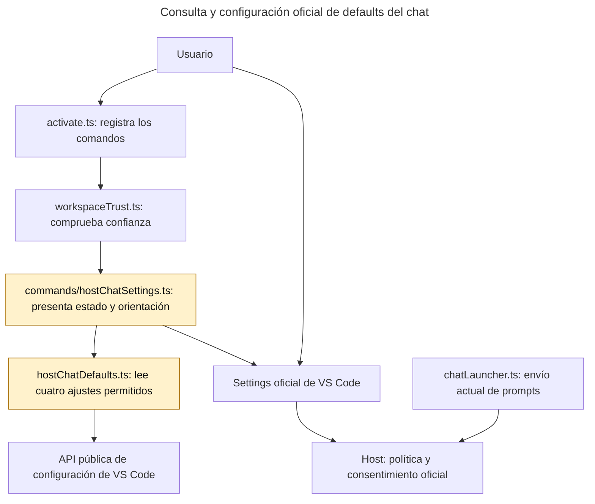

# ADR-022: Defaults globales del chat mediante configuración oficial del host

- **Estado:** aceptado
- **Fecha:** 21 de octubre de 2026
- **Aprobación:** el maintainer aprobó la opción C el 21 de octubre de 2026. La aceptación de la decisión no acredita implementación ni validación de seguridad.
- **Issue:** [SrScorpio/alfred-ralph-suite#14](https://github.com/SrScorpio/alfred-ralph-suite/issues/14) y [SrScorpio/alfred-ralph-suite#15](https://github.com/SrScorpio/alfred-ralph-suite/issues/15): reapertura propuesta con alcance reducido; no implica su cierre ni un cambio de estado en GitHub.
- **Enmienda parcialmente:** ADR-019, exclusivamente respecto al bloqueo absoluto de #14/#15.
- **Relacionado:** ADR-016 (propuesto), ADR-017 y ADR-018.
- **Precisión de arquitectura:** excepción de lectura acotada de configuración del host; se mantiene la prohibición de escribir ajustes ajenos.

## Contexto

ADR-019 bloqueó el modo Autopilot y «autorizar todo» porque el host no exponía la superficie requerida. Su cláusula final exige revisar la decisión cuando esa superficie cambie. Este ADR registra la enmienda sin modificar el registro histórico del ADR-019.

La evidencia ya verificada en el bundle local de VS Code 1.142.0, commit `6d62b1d5`, y en `microsoft/vscode` identifica estos ajustes:

- `chat.permissions.default`: nivel de permisos por defecto de sesiones nuevas; enum `default | autoApprove | autopilot`. `getDefaultPermissionLevel()` lo lee con fallback `default`; el host reacciona a cambios en una sesión vacía.
- `chat.tools.global.autoApprove`: autoaprobación de herramientas a nivel de aplicación, sujeta a política empresarial y con warning oficial del host en el primer uso. El changelog documenta su renombrado en 1.104, sin migración automática.
- `chat.newSession.defaultMode`: modo por defecto de sesiones nuevas; vacío significa el predeterminado de la vista.
- `chat.autopilot.advanced.enabled`: extras de Autopilot, incluidos goal banner y risk gate que omite herramientas de riesgo alto; no selecciona por sí mismo Autopilot.

Las fuentes verificadas de `microsoft/vscode` son `src/vs/workbench/contrib/chat/common/agentHostConfigPolicy.ts`, `src/vs/platform/agentHost/node/sessionPermissions.ts`, `src/vs/platform/agentHost/common/agentHostSchema.ts`, `src/vs/workbench/contrib/chat/common/constants.ts`, `src/vs/workbench/contrib/chat/browser/chat.shared.contribution.ts` y `extensions/copilot/CHANGELOG.md`.

Esta superficie configura defaults o comportamiento global. No constituye una API soportada para crear sesiones aisladas por tarea, modificar sus permisos individualmente ni garantizar el modo de una sesión activa. El valor `autopilot` del nivel de permisos no autoriza a inventar un valor equivalente para `chat.newSession.defaultMode`.

La extensión admite VS Code desde 1.103.0 y no puede asumir que todas las claves estén disponibles. La política empresarial puede restringir su comportamiento. `policyValue` en la implementación interna del host no implica un campo público utilizable en `WorkspaceConfiguration.inspect()`.

La arquitectura vigente prohíbe leer o escribir ajustes ajenos. ADR-018 rechaza las escrituras cruzadas y la interpretación de ajustes de Alfred como propios. Se necesita una excepción explícita de lectura del host, no un cambio silencioso de esas reglas.

## Opciones consideradas

### Opción A: aplicar ajustes globales con opt-in explícito

**Ventajas:** configuración rápida mediante una acción.

**Inconvenientes:** modifica comportamiento ajeno al proyecto, necesita una excepción de escritura y añade restauración, compatibilidad y validación del consentimiento del host. Instalar la suite no implica querer cambiar los permisos globales del equipo, tampoco mediante una invitación automática en el primer arranque.

### Opción B: preferencias propias con aplicar y revertir

**Ventajas:** expresa una intención de configuración y ofrece una acción de restauración.

**Inconvenientes:** duplica la fuente de verdad y añade conflictos entre intención, configuración guardada, política y estado efectivo. Revertir exige conservar la presencia o ausencia y el valor previo exacto, sin sobrescribir cambios posteriores del usuario.

### Opción C: abrir configuración oficial y consultar estado en solo lectura

**Ventajas:** conserva al host como autoridad, no modifica ajustes, mantiene su UI y evita gestionar restauraciones.

**Inconvenientes:** requiere un paso manual y no automatiza la activación.

### Opción D: orientación más aplicación global opt-in

**Ventajas:** combina orientación y comodidad.

**Inconvenientes:** conserva los riesgos y obligaciones de A, además de mantener dos rutas de configuración.

## Decisión

Se elige la **opción C**, con consulta de estado en solo lectura.

1. La suite ofrecerá `ralph-suite.openHostChatSettings` para abrir la configuración oficial y `ralph-suite.showHostChatDefaults` para consultar su estado.
2. No escribirá ajustes del host, ni al activar la extensión, ni al iniciar un flujo, ni al lanzar tareas. No habrá aviso automático de configuración al arrancar.
3. No incorporará settings propios que repliquen los defaults del host.
4. La lectura de las cuatro claves enumeradas constituye una excepción limitada a la regla de no leer configuración ajena. No autoriza lecturas de `alfred-dev.*` ni otras claves.
5. Los comandos comprobarán workspace trust mediante el helper existente. Se mantiene `untrustedWorkspaces.supported: false`. El trust del workspace actual no confina el efecto de un ajuste global a ese proyecto.
6. La modificación permanecerá bajo control del host mediante Settings. No se aceptarán warnings automáticamente ni se silenciarán diálogos. No se ofrecerá una ruta de escritura alternativa.
7. La UI distinguirá configuración consultada de permisos efectivos de sesión. Mostrará valores desconocidos o no disponibles sin sustituirlos por defaults ficticios.
8. Los modos de nueva sesión, los niveles de permisos y los extras de Autopilot se presentarán como conceptos distintos.
9. La suite no accederá a APIs internas de política. Cuando no pueda determinar una restricción mediante API pública, remitirá a Settings sin inventar un diagnóstico. Un valor devuelto por `get()` o `inspect()` no certifica por sí solo que la clave esté registrada y soportada.
10. #14/#15 podrán reabrirse para orientación y consulta de defaults globales. Si mantienen como requisito la aplicación automática, este alcance no será suficiente para cerrarlas.
11. Permanecen vigentes la concurrencia 1, `maxLoops` y las reglas de entrada por `@alfred` establecidas en ADR-019. Este ADR no resuelve discrepancias previas de direccionamiento.
12. Se leerá el estado por acción, con actualización manual y sin persistencia ni sincronizador en segundo plano. Un fallo de lectura o apertura se mostrará sin romper el extension host ni ejecutar reintentos automáticos.

### Diagrama de límites

**Leyenda:** flechas = invocación o consulta; cajas = componentes; amarillo = módulos previstos, todavía no implementados. Los demás componentes existen; el registro de los dos comandos es trabajo pendiente. No hay escritura de configuración desde la suite. `chatLauncher.ts` conserva su responsabilidad de envío de prompts y no administra permisos.

## Gates que permanecen vigentes

### SrScorpio/alfred-ralph-suite#12: `maxParallelTasks`

Continúa bloqueada hasta disponer de:

- API pública y soportada para sesión aislada por tarea, iniciada con `@alfred` y su primer prompt, sin trucos de UI;
- aislamiento demostrado por tests;
- scheduler propiedad de Ralph, reservas o leases y heartbeat;
- concurrencia limitada, abort individual y abort global;
- resultados terminales idempotentes y recuperación tras reinicio sin duplicaciones ni pérdidas;
- validación de trust, multi-root, dependencias y ausencia de escrituras del PRD;
- permisos transparentes antes de ejecutar;
- validación de seguridad específica y compatibilidad real de la API de Chat o del motor elegido.

### SrScorpio/alfred-ralph-suite#13: política por sesión/acción

Continúa bloqueada hasta disponer de una API pública y soportada que permita asociar y aplicar la política a la sesión o acción concreta, verificar su alcance y mantener el consentimiento del host.

Modificar temporalmente defaults globales antes de abrir un chat **no satisface esta gate**. Varias llamadas concurrentes a `runTask` tampoco proporcionan sesiones aisladas.

## Criterios de aceptación

- Los dos comandos están contribuidos y registrados, sin settings nuevos.
- La activación no consulta configuración del host ni abre su UI; la activación y los comandos producen cero llamadas a `configuration.update()`.
- Solo se consultan las cuatro claves autorizadas del host, además del trust actual y la versión informativa de VS Code.
- La UI muestra los valores consultados y advierte de que no describen una sesión activa.
- Settings es la única ruta de modificación ofrecida; se prueba la búsqueda combinada y existe alternativa por clave.
- Settings ausentes, valores desconocidos y errores de lectura o apertura no rompen la extensión.
- Se valida VS Code 1.103 y la versión 1.142.0 de referencia, con resultados por clave. El renombrado en 1.104 no se usa como fecha de introducción de todos los ajustes.
- Se valida una configuración empresarial real; los mocks no acreditan el comportamiento de policy.
- Se observa el warning oficial de autoaprobación en un entorno de prueba con primer uso, sin intervención automática de la suite.
- No se modifican runner, protocolo runtime, PRD, direccionamiento ni aislamiento de sesiones.
- Los tests cubren lectura, trust, cancelación, actualización manual, errores y ausencia de escrituras; la suite existente sigue pasando.
- Seguridad revisa consentimiento, alcance global y política empresarial antes de desarrollar. La aprobación del maintainer del 21/10/2026 satisface la aprobación del enfoque, no sustituye esta validación.

## Consecuencias

Se elimina el bloqueo absoluto de #14/#15 para un alcance de orientación y consulta. No se obtiene automatización por tarea ni garantía sobre sesiones existentes. No se declara su cierre con esta decisión documental.

Se mantiene una única fuente de verdad: el host. La suite evita gestionar permisos persistentes, restauraciones y conflictos entre ventanas. La excepción de lectura queda limitada a cuatro claves y no amplía la integración con Alfred.

El coste aceptado es una configuración manual. Si no se implementa esta integración, no hay degradación funcional: permanece el runner serial y el usuario puede configurar el host directamente.

Cualquier futura aplicación global exige otro ADR y validación específica; no se añadirá como extensión silenciosa de estos comandos. No se introducen dependencias, polling ni infraestructura nueva.
